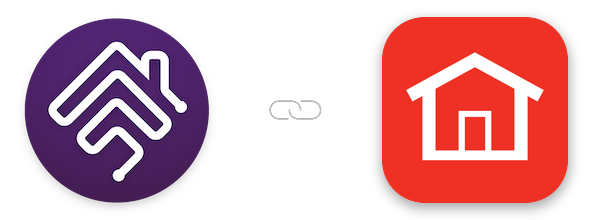

   

## homebridge-resideo

Homebridge plugin to integrate Resideo (Honeywell Home) devices into HomeKit

 
 

### Plugin Information

- This plugin allows you to view and control your [Resideo](https://www.resideo.com) (Honeywell Home) devices within HomeKit. The plugin:
  - requires a (free) Resideo developer account to work - this is separate from the Resideo account you use in the Resideo app
  - connects to the Resideo cloud to discover and control your devices
  - uses Matter automatically when Matter is turned on in Homebridge, and uses HomeKit (HAP) otherwise

### Prerequisites

- To use this plugin, you will need to already have:
  - [Node](https://nodejs.org): latest version of `v22`, `v24` or `v26` - any other major version is not supported.
  - [Homebridge](https://homebridge.io): `v2` - refer to link for more information and installation instructions.

### Setup

- [Installation](https://github.com/homebridge-plugins/homebridge-resideo/wiki/Installation)
- [Configuration](https://github.com/homebridge-plugins/homebridge-resideo/wiki/Configuration)
- [Beta Version](https://github.com/homebridge-plugins/homebridge-resideo/wiki/Beta-Version)
- [Node Version](https://github.com/homebridge-plugins/homebridge-resideo/wiki/Node-Version)

### Supported Devices

- T10 Thermostat - already HomeKit certified
- T9 Thermostat - already HomeKit certified
  - T9 Smart Roomsensors
- T6 Thermostat - already HomeKit certified
- T5 Thermostat - already HomeKit certified
- Round Thermostat - already HomeKit certified
- Some Total Comfort Control thermostats
  - Pushing commands may not be supported on some.
- WiFi Water Leak & Freeze Detector
- Water Shutoff Valves

### Help/About

- [Common Errors](https://github.com/homebridge-plugins/homebridge-resideo/wiki/Common-Errors)
- [Support Request](https://github.com/homebridge-plugins/homebridge-resideo/issues/new/choose)
- [Changelog](https://github.com/homebridge-plugins/homebridge-resideo/blob/latest/CHANGELOG.md)

### Credits

- To [@donavanbecker](https://github.com/donavanbecker): the original creator and maintainer of this plugin.
- To the creators/contributors of [Homebridge](https://homebridge.io) who make this plugin possible.

### Disclaimer

- I am in no way affiliated with Resideo or Honeywell and this plugin is a personal project that I maintain in my free time.
- Use this plugin entirely at your own risk - please see licence for more information.
